# Luma 拾光 · 产品说明

> 一款移动端优先的本地智能图片管家：导入照片后自动分相册、给出可解释的清理建议、用带背景音乐的幻灯片重新浏览，并可按需开启云端模型增强。

本文档面向产品与设计评审，逐场景说明界面、功能与交互，并附全部界面截图。截图来自内置「演示相册」（13 张程序化生成的照片，覆盖 7 个相册、1 组重复、1 组相似、3 张画质问题照片），因此无需准备素材即可复现本文所有结果。

---

## 一、产品定位

手机相册的典型困境是照片越攒越多、找不到、不敢删。Luma 拾光把这三件事拆成三个明确动作：**自动归类**让照片各归其位，**清理建议**让删除有据可依，**沉浸幻灯片**让回看重新变得愉快。

所有默认能力都在浏览器内完成，照片与派生数据保存在本机 IndexedDB，原图不会离开设备。云端模型增强作为可选项存在，默认关闭，且开启后也只上传长边 640px 的压缩样张。

## 二、目标用户与典型场景

| 用户 | 场景 | 期望结果 |
| --- | --- | --- |
| 手机照片堆积的用户 | 攒了几千张没整理 | 打开即按人物、风景、美食、夜景等自动分好 |
| 想清理又不敢删的用户 | 空间告急，不知道删哪些 | 给出重复、相似、模糊、曝光、低分辨率的具体清单与理由 |
| 有整理癖好的用户 | 想手动纠正归类 | 一张照片可同时归入多个相册，且手动结果优先于自动结果 |
| 爱回看的用户 | 睡前、通勤时翻旧照片 | 全屏幻灯片、随机播放、内置背景音乐 |
| 注重隐私的用户 | 不愿上传照片到云端 | 本地链路完整可用，云端开关由自己决定 |

## 三、设计原则

1. **本地优先**：图像分析在浏览器 Web Worker 中完成，原图与结果留在本机。
2. **可解释**：每一条清理建议都给出原因（画面模糊、曝光偏暗、短边仅 420px 等），每张照片都能看到画质分与模型点评。
3. **可撤销**：删除前逐张确认，手动归类可一键「恢复自动整理」。
4. **一张照片、多个相册**：相册是观察视角，允许重叠，避免被迫二选一。

## 四、界面结构

底部四个标签构成主干：**图库 / 相册 / 清理 / 幻灯片**，中间的上传按钮随时可用。照片详情、相册归类、云端增强、删除确认以底部弹层呈现，保证单手可达。

---

## 五、场景走查

### 场景 1：首次进入

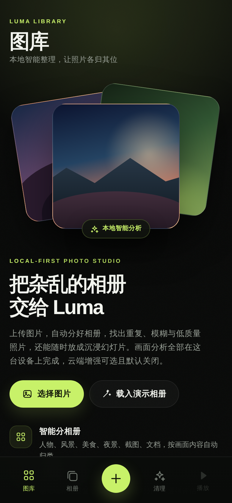

空状态即引导页：顶部是程序化绘制的品牌插画，中部给出定位说明与功能亮点（本地分析、自动分相册、清理建议、幻灯片），底部说明隐私承诺并提供「载入演示相册」入口。右上角常驻云朵图标，是云端增强的入口。

### 场景 2：导入照片

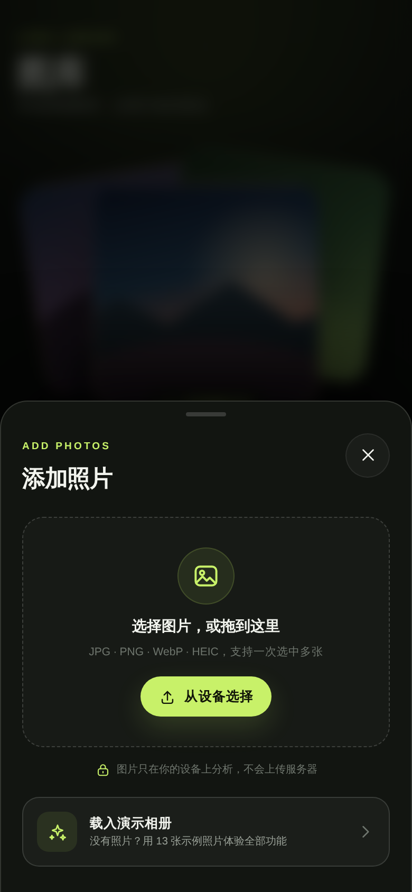

点击底部加号打开导入面板。支持点击选择与拖拽投递两种方式，格式覆盖 JPG、PNG、WebP、HEIC，可一次选中多张。面板底部固定隐私说明，并保留「载入演示相册」入口，方便随时用演示数据体验。

### 场景 3：本地分析

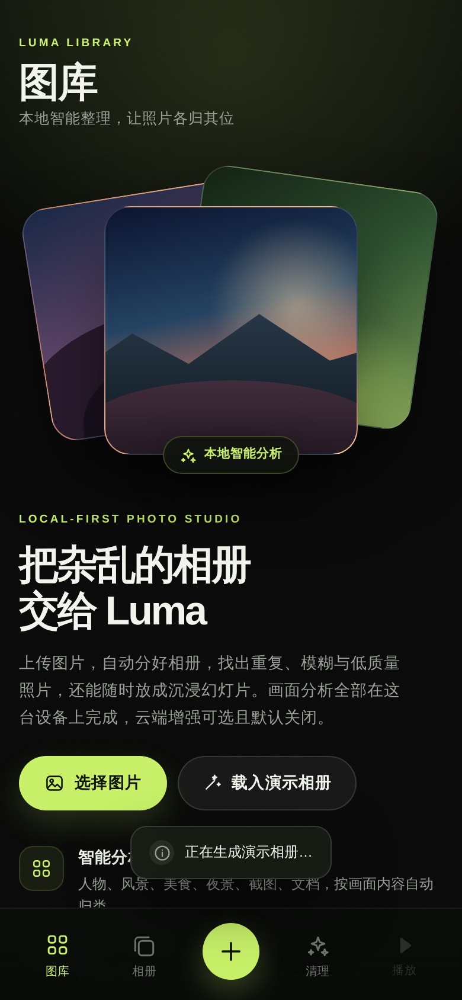

导入后立即开始分析，底部浮出进度条并显示已完成张数（智能分析中 n/13）。分析在 Web Worker 中执行，主线程保持可交互，因此进度条出现的同时仍可继续操作。演示相册 13 张照片的完整分析耗时约 4.5 秒。

每张照片会产出 16x16 差异哈希、8x8x3 分块颜色指纹，以及亮度、对比度、饱和度、清晰度、边缘密度、色彩分布、肤色占比、暗部占比、天空占比等指标，这些指标同时服务于归类、画质评分与问题检测。

### 场景 4：图库总览

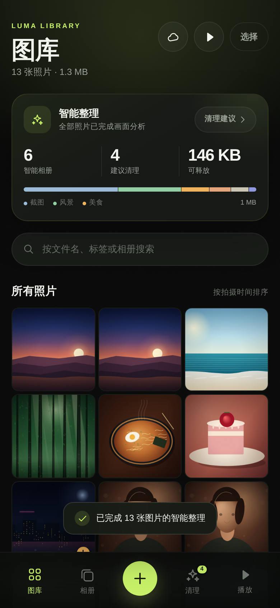

图库以时间倒序的网格展示全部照片。页头汇总照片数量与容量占用（本例 13 张照片 · 1.3 MB），并提供云端增强、播放全部、批量选择三个入口。

网格上方是「智能整理」卡片，一行给出核心结论：6 个智能相册 · 4 条建议清理 · 可释放 146 KB，并显示分析状态（全部照片已完成画面分析）与清理建议入口。卡片下方继续展开相册分布与画质分布，把分析结果直接摊开给用户看。

每张缩略图角标显示所属相册与画质分，便于快速扫读。

### 场景 5：自然语言检索

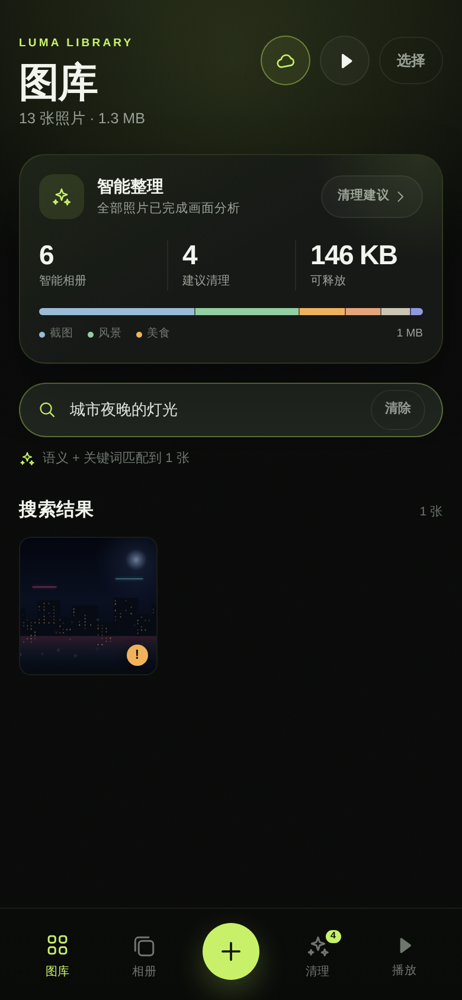

搜索框支持自然语言描述。示例中「城市夜晚的灯光」精准命中了城市夜景一张，提示条显示「语义 + 关键词匹配到 1 张」，说明本次结果来自云端语义与关键词的融合。

检索链路分三层：向量相似度决定哪些照片进入候选，重排模型决定候选顺序，本地词法命中作为兜底。云端不可用时自动退化为纯关键词检索，功能不中断。

### 场景 6：没有匹配

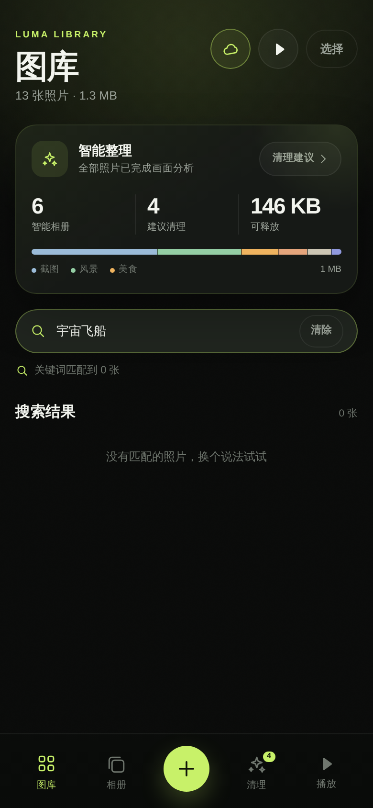

「宇宙飞船」这类与图库毫无关联的查询返回 0 张，并给出「没有匹配的照片，换个说法试试」的引导。这里刻意不做「退而求其次」的全量返回，避免用户误以为全部照片都相关。

### 场景 7：相册总览

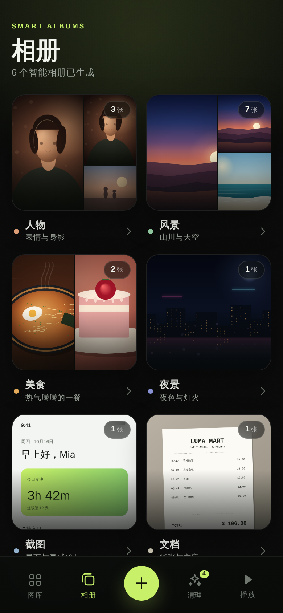

相册页展示 7 个自动相册（人物、风景、美食、夜景、截图、文档、日常）及各自的数量与封面拼贴：本例 6 个相册已有照片，尚未归入内容的「日常」显示「等待照片」。相册封面取该相册内画质较高的照片，视觉上一眼可辨。页面底部提示相册会自动随新照片更新。

### 场景 8：相册详情

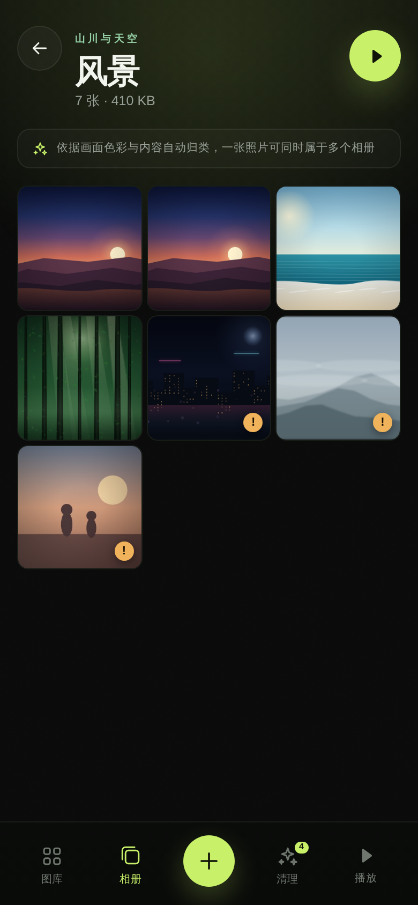

进入相册后可看到该相册的全部照片，页面标注「依据画面色彩与内容自动归类，一张照片可同时属于多个相册」。右上角的播放按钮可直接以当前相册为范围启动幻灯片。

### 场景 9：开启云端增强

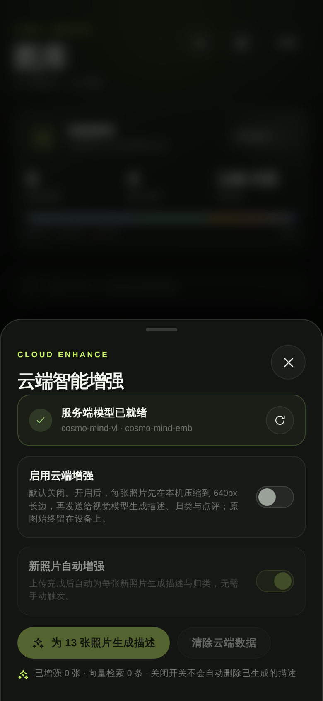

云端面板先做服务状态检测：服务端模型就绪时显示可用模型（本例 cosmo-mind-vl 与 cosmo-mind-emb），未配置时给出填写 `.env` 的指引。

两个开关的语义清晰分层：**启用云端增强**决定是否允许照片出设备，**新照片自动增强**决定是否需要手动触发。开关旁直接写明「每张照片先在本机压缩到 640px 长边，再发送给视觉模型，原图始终留在设备上」。

### 场景 10：增强进行中

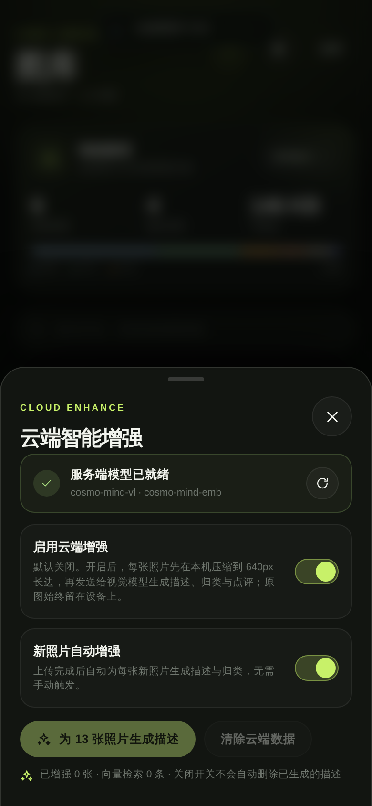

开启后点击增强按钮，按钮进入忙碌状态并显示剩余张数（增强剩余 n 张）。请求按 4 张一批合并发送，兼顾速度与上游调用配额；每张完成后立即写入本地，进度可见、不会因为中途失败而丢失已完成的结果。

演示相册 13 张照片的云端增强耗时约 14.4 秒。

### 场景 11：增强完成

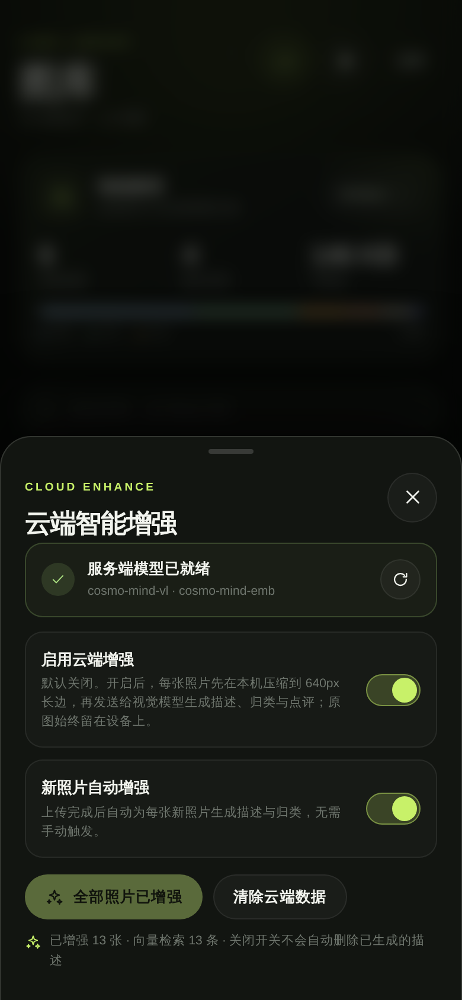

完成后按钮变为「全部照片已增强」，随时可再次打开面板查看状态。增强结果包括：一句中文描述、3 到 5 个中文关键词、AI 归类（含置信度）、一句话画质点评。

### 场景 12：照片详情与模型洞察

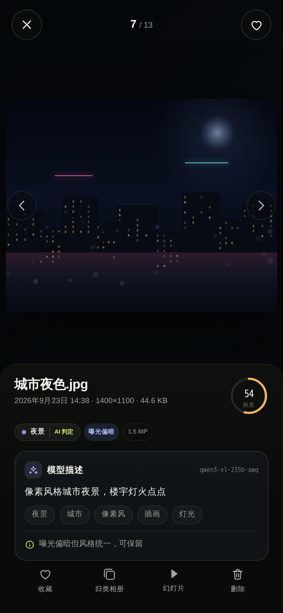

详情页自上而下：大图浏览区、相册标签（带来源标记，如「AI 判定」即由模型判定）、画质分与检测到的问题标签、模型洞察卡、以及收藏 / 归类相册 / 幻灯片 / 删除四个操作。

示例中城市夜色.jpg 得到 54 分画质、标记「曝光偏暗」、归类为夜景，模型点评为「曝光偏暗但风格统一，可保留」。点评聚焦「这张照片是否值得保留」这一决策，与清理流程直接衔接。

### 场景 13：多相册归类

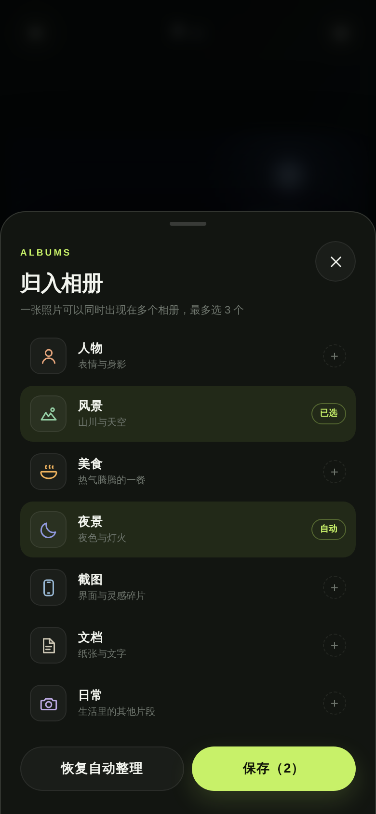

点击「归类相册」打开多选弹层。每行显示相册名、说明与状态标记（自动 / 已选），最多可选 3 个。手动选择会覆盖自动结果，来源标记为「手动」。

### 场景 14：相册标签生效

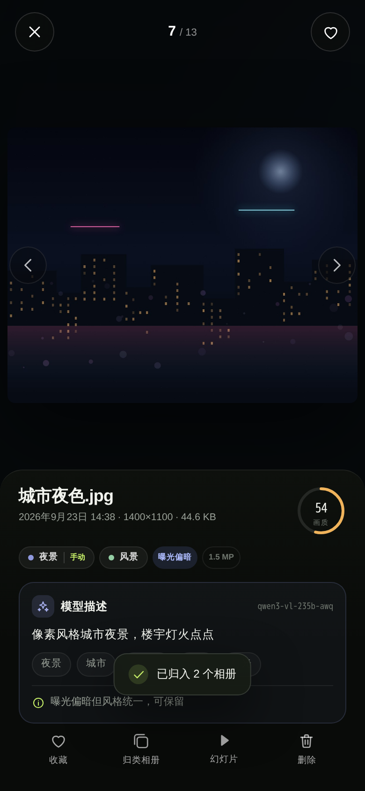

保存后，详情页顶部会同时显示多个相册标签，本张照片因此可同时出现在「夜景」与「风景」两个相册中。标签区提供「恢复自动整理」，一键交还给自动结果。

### 场景 15：删除确认

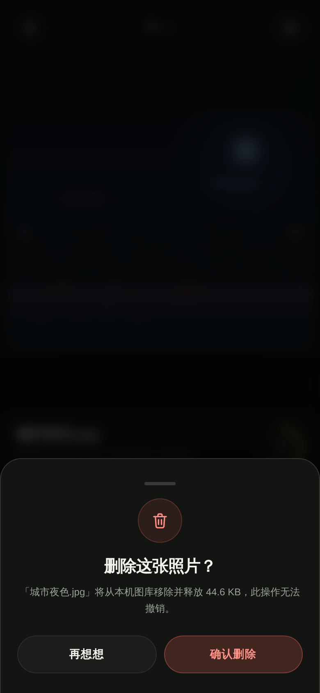

任何删除都经过确认弹层，文案说明影响范围（含释放空间），默认停留等待用户判断，避免误触。

### 场景 16：清理建议

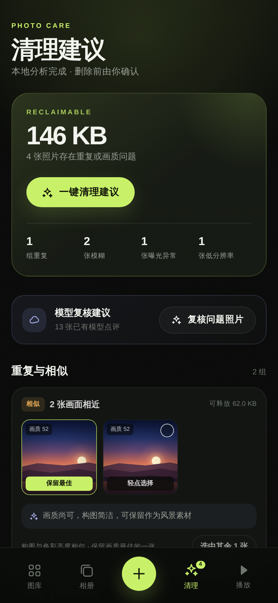

清理页是本产品的核心价值页面：

- 顶部大字给出**预计可释放空间**（演示数据 146 KB）与问题概览：4 张照片存在重复或画质问题，含 1 组重复、2 张模糊、1 张曝光异常、1 张低分辨率。
- 指标胶囊列出各问题的出现次数与可释放量。
- **模型复核**区块在云端增强后出现，提供「复核问题照片」入口，把本地检测结果交给模型二次判断。

### 场景 17：重复与画质问题清单

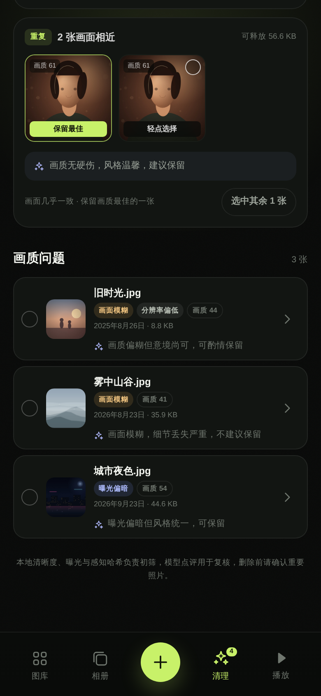

「重复与相似」分组把画面相近的照片并排展示，自动标出「保留最佳」的一张（画质分最高），其余可一键「选中其余 N 张」；每组还附上模型对保留项的点评，帮助用户判断是否值得留。

「画质问题」列表逐张给出原因标签、拍摄信息、画质分与处理建议（例如雾中山谷.jpg「画面模糊严重，细节丢失，不建议保留」）。所有选择汇聚到底部操作条，统一确认后删除。

### 场景 18：幻灯片播放

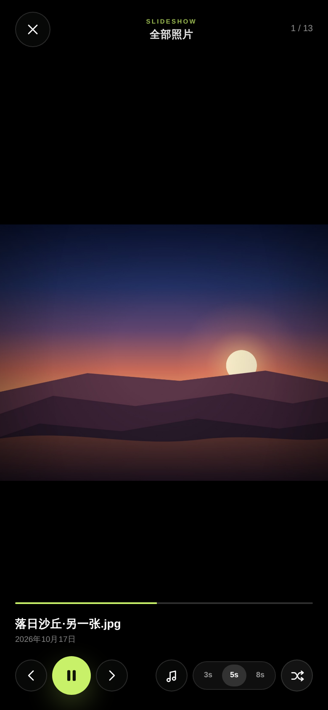

幻灯片支持以全部照片或单个相册为范围播放，提供 3s / 5s / 8s 三档间隔、随机播放、Ken Burns 缓慢推拉动效。顶部显示播放范围（全部照片）与当前序号（1 / 13），底部提供播放控制、随机开关、音乐按钮与进度条。

交互细节：轻点画面隐藏全部控件，获得纯净观赏；左右滑动或方向键切换；`Esc` 退出；`M` 键随时开关音乐。

### 场景 19：背景音乐

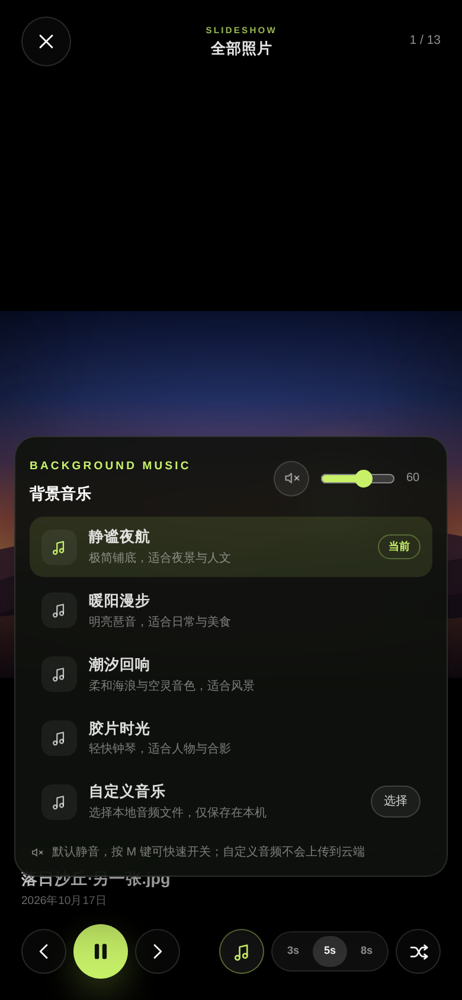

音乐面板列出 4 首内置曲目（静谧夜航、暖阳漫步、潮汐回响、胶片时光），每首标注适用场景；当前曲目标记「当前」。面板顶部是静音按钮与音量滑杆。

内置曲目由 WebAudio 实时合成，不依赖任何音频资源文件，因此首屏体积不受影响。

### 场景 20：自定义音乐

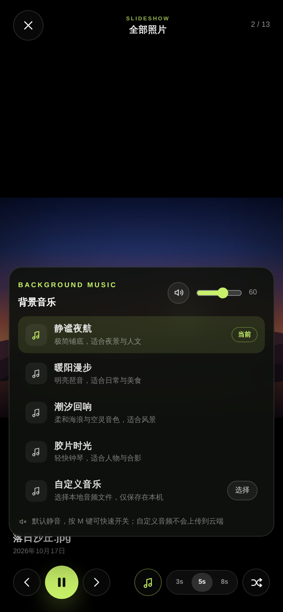

用户可选择本地音频作为自定义背景音乐，文件仅保存在本机 IndexedDB，不会上传到云端；选择后自动切换并显示文件名，可随时移除。音乐默认静音，需用户主动开启。

### 场景 21：桌面端

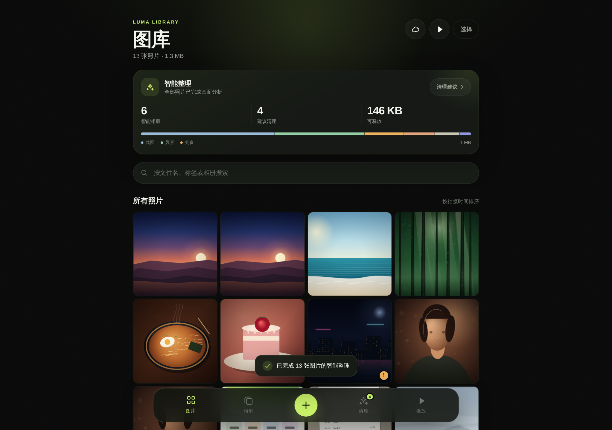

布局随宽度自适应，桌面端自动切换为多列网格并展开侧边信息，手机、平板、桌面共用一套组件。

---

## 六、功能清单

| 模块 | 能力 | 说明 |
| --- | --- | --- |
| 导入 | 点击 / 拖拽批量导入 | 支持 JPG、PNG、WebP、HEIC，读取 EXIF 拍摄时间 |
| 本地分析 | 指纹与画质指标 | 16x16 dHash、8x8x3 分块指纹、十余项画面指标，Web Worker 内完成 |
| 自动归类 | 7 个相册、多标签 | 每类独立打分，主类别取最高分，高分次要类别一并保留 |
| 手动归类 | 多选相册 | 最多 3 个，来源标记「手动」，优先级最高，可恢复自动 |
| 画质评分 | 0-100 分 | 综合清晰度、分辨率、曝光、对比度、饱和度 |
| 问题检测 | 重复、相似与 4 类画质问题 | 重复与相似基于指纹，画质问题含模糊、曝光偏暗、曝光过度、分辨率偏低 |
| 清理 | 分组与清单 | 自动标出保留项、支持整组选中、统一确认后删除 |
| 检索 | 关键词 + 语义 | 本地词法始终可用；云端开启后启用向量与重排融合 |
| 详情 | 大图与洞察 | 相册标签、问题标签、画质分、模型描述、关键词与点评 |
| 幻灯片 | 播放与动效 | 全部 / 单相册范围、三档间隔、随机、Ken Burns |
| 背景音乐 | 内置 + 自定义 | 4 首实时合成曲目，可上传本地音频、调音量、默认静音 |
| 云端增强 | 描述 / 归类 / 点评 | 可选开启，上传 640px 压缩样张，密钥仅存服务端 |

## 七、数据与隐私

- 原图、分析结果、归类、向量与自定义音乐全部保存在本机 IndexedDB（数据库 `luma-photo-db`）。
- 云端增强默认关闭；开启需要用户在面板中明确操作，开关旁即时说明上传内容与压缩策略。
- 云端请求经由自建 Node 代理转发，模型密钥只存在于服务端环境变量，前端代码与网络请求中都不出现密钥。
- 自定义背景音乐保存在本机，不会参与任何上传。

## 八、实测表现

**本地归类**（演示相册 13 张，主类别与配置一致，6 张获得多标签）：

| 照片 | 主类别 | 置信度 | 相册 |
| --- | --- | --- | --- |
| 城市夜色.jpg | 夜景 | 0.96 | 夜景、风景 |
| 深夜拉面.jpg | 美食 | 0.97 | 美食、夜景 |
| 购物小票.jpg | 文档 | 0.97 | 文档 |
| 手机截图.png | 截图 | 0.97 | 截图 |
| 逆光肖像.jpg | 人物 | 0.93 | 人物 |
| 雾中山谷.jpg | 风景 | 0.81 | 风景 |
| 落日沙丘.jpg | 风景 | 0.87 | 风景、夜景 |
| 森林光束.jpg | 风景 | 0.97 | 风景 |
| 海岸线.jpg | 风景 | 0.97 | 风景 |
| 草莓蛋糕.jpg | 美食 | 0.97 | 美食 |
| 旧时光.jpg | 人物 | 0.97 | 人物 |

**检索**（云端增强后实测）：

| 查询 | 结果 |
| --- | --- |
| 城市夜晚的灯光 | 命中 城市夜色.jpg |
| 纸质凭证 | 命中 购物小票.jpg |
| 落日 | 命中两张落日沙丘 |
| 蛋糕 | 命中 草莓蛋糕.jpg |
| 宇宙飞船 | 0 张，给出无匹配引导 |

**性能**（演示相册 13 张）：本地分析约 4.5 秒，云端增强约 14.4 秒。

**清理**（演示数据）：预计可释放 146 KB，2 组相近照片（1 组重复、1 组相似），3 张画质问题照片。

## 九、已知边界

- 归类依据画面色彩与纹理统计，画面风格化明显的插画、滤镜照片可能出现标签偏多，手动归类与模型归类可覆盖。
- 云端增强受上游模型服务配额限制，批量处理速度取决于配额与网络状况。
- 自定义背景音乐的格式支持取决于浏览器解码能力，推荐 MP3 / M4A / WAV。
- 检索质量与云端可用性相关，云端不可用时退化为关键词检索，此时同义词类查询的召回会下降。
