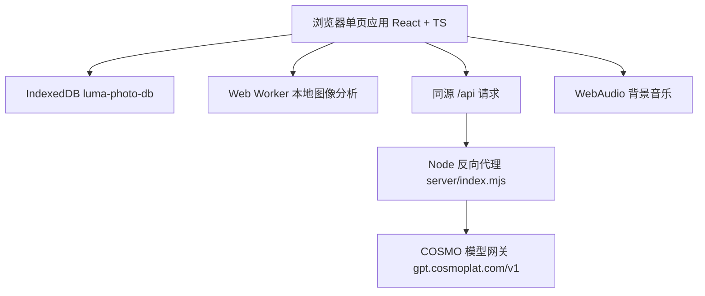

# Luma 拾光 · 智能图片管家

移动端优先的本地智能图片管理 Web 应用：导入照片后自动分相册、给出删除建议、支持带背景音乐的沉浸幻灯片，并可选择性开启云端模型增强。

图片的默认处理链路全部在浏览器内完成，原图保存在本机 IndexedDB，不会离开设备。

## 核心能力

### 导入与本地分析

- 点击或拖拽批量导入图片，读取 EXIF 拍摄时间回填时间线
- 分析在 Web Worker 中执行，主线程保持流畅；采样尺寸 192px，单张耗时约几十毫秒
- 每张照片产出：`dHash 16x16` 相似哈希、`8x8x3` 分块颜色指纹、亮度、对比度、饱和度、清晰度、边缘密度、白/绿/蓝/暖/肤色占比、暗部与天空占比、主色调色板
- 依据指纹自动识别重复与相似照片，结果集中呈现在清理页

### 多相册自动归类

7 个相册：人物、风景、美食、夜景、截图、文档、日常。

分类器对每个类别独立计算 0-1 的可信度，主类别取最高分，高分次要类别一并保留，因此一张照片可以同时出现在多个相册（例如"深夜拉面"同时进入美食与夜景）。文件名与画面内容共同参与判断（`截图`、`发票`、`小票` 等命名会直接影响归类）。

在照片详情页可手动指定相册，最多 3 个，来源标记为「手动」并拥有最高优先级；随时可以「恢复自动整理」，交还给自动结果。

### 清理建议

- **重复照片**：汉明距离 ≤ 8 且颜色距离 ≤ 1
- **相似照片**：汉明距离 ≤ 24 且颜色距离 ≤ 2.6
- **画面模糊**、**曝光偏暗**、**曝光过度**、**分辨率偏低**
- 按可释放空间排序，逐张确认后删除，支持模型复核与画质点评

### 幻灯片

- 播放范围可选「全部照片」或某个相册
- 播放间隔 3s / 5s / 8s，支持随机播放与 Ken Burns 缓慢推拉
- 键盘快捷键：空格暂停、左右方向键切换、`Esc` 退出、`M` 开关音乐
- **背景音乐**：默认静音。内置 4 首曲目（静谧夜航、暖阳漫步、潮汐回响、胶片时光），使用 WebAudio 实时合成，无需音频资源文件；支持上传自定义音频（存入 IndexedDB）与音量调节

### 检索

- 云端关闭时使用本地词法检索（中文二元组分词 + 标签/文件名加权），始终可用
- 云端开启后启用融合检索：向量余弦判断准入、重排模型决定排序、词法命中作为兜底
- 无匹配时返回空结果，并给出「没有匹配的照片」提示

### 版本说明

图库页右上角提供一枚弱化样式的信息图标，点击打开版本说明弹层：版本号、发布日期、更新要点与运行说明。版本号在构建时由 `vite.config.ts` 从 `package.json` 注入（`__APP_VERSION__`），界面与发布版本不会脱节。

## 技术栈

| 层 | 选型 |
| --- | --- |
| 前端 | React 18 + TypeScript + Vite 6 |
| 样式 | 原生 CSS（自定义属性主题，深色为主） |
| 本地存储 | IndexedDB（库名 `luma-photo-db`，版本 3） |
| 计算 | Web Worker（图像分析）、WebAudio（背景音乐合成） |
| 后端 | Node 内置 `http`，零第三方依赖 |
| 测试 | Vitest（单元测试）、Playwright（端到端校验） |

## 快速开始

```bash
# 安装依赖
npm install

# 配置模型密钥（可选，仅云端增强需要）
cp .env.example .env
```

编辑 `.env` 填入 `COSMO_API_KEY`。参考 `.env.example`：

```bash
COSMO_API_BASE=https://gpt.cosmoplat.com/v1
COSMO_API_KEY=replace-with-your-key
COSMO_MODEL_VISION=cosmo-mind-vl
COSMO_MODEL_TEXT=cosmo-mind
COSMO_MODEL_EMBED=cosmo-mind-emb
COSMO_MODEL_RERANK=cosmo-mind-rerank
PORT=8787
```

### 运行

```bash
# 生产方式运行：同时启动 API 服务（8787）与生产预览（4173）
npm run serve

# 仅启动 API 服务
npm run api

# 开发服务器（仅前端，需另行启动 API）
npm run dev
```

访问 http://localhost:4173 即可打开首页。图库顶部提供「载入演示相册」，可一键载入 13 张程序化生成的照片，快速体验分类、清理与幻灯片。

产品说明的 HTML 版由同一端口提供：访问 http://localhost:4173/docs 即可阅读（也可从图库页右上角的版本说明入口进入）。

### 构建与测试

```bash
# 生产构建（tsc -b && vite build，产物在 dist/）
npm run build

# 单元测试
npm test

# 由 .cosmocode/docs/产品说明.md 生成同名 HTML 文档
npm run docs:html
```

容器内存受限时，请用生产构建 + 预览（`npm run serve`）进行验收：开发模式的编译与热重载内存峰值明显更高。

## 隐私模型

- 本地分析为默认且完整的路径，原图与全部派生数据留在本机 IndexedDB
- 云端增强默认关闭，需要用户在「云端智能增强」面板中主动开启并确认授权
- 开启后上传的是长边 640px 的压缩样张，用于生成描述、AI 归类、画质点评与检索向量
- 模型密钥只存放于服务端 `.env`（已被 `.gitignore` 忽略），前端代码与网络请求中都不出现密钥

## 架构



对外只暴露一个端口：开发服务器与预览服务器都把 `/api` 反向代理到本机 8787 的 Node 服务（见 `vite.config.ts`）。

## 目录结构

```
.
├── index.html              # 入口页面
├── server/
│   ├── index.mjs           # Node API 代理：密钥注入、限流、超时、错误映射
│   └── serve.mjs           # 同时拉起 API 服务与生产预览
├── src/
│   ├── App.tsx             # 标签页与视图编排
│   ├── main.tsx            # 应用入口
│   ├── styles.css          # 全局样式与主题
│   ├── components/         # 视图与交互组件
│   │   ├── LibraryView.tsx   # 图库、搜索、上传入口
│   │   ├── AlbumsView.tsx    # 相册浏览
│   │   ├── CleanupView.tsx   # 清理建议与确认
│   │   ├── Slideshow.tsx     # 幻灯片与背景音乐面板
│   │   ├── Viewer.tsx        # 照片详情、多相册归类
│   │   ├── CloudSheet.tsx    # 云端增强面板
│   │   ├── VersionSheet.tsx  # 版本说明弹层
│   │   └── ...               # Sheet / PhotoGrid / Icons / TabBar 等
│   └── lib/
│       ├── analysis.ts       # 图像指标、哈希、指纹、分类、质量与问题检测
│       ├── analyzer.worker.ts# 分析任务的工作线程
│       ├── db.ts             # IndexedDB 读写（含背景音乐、检索向量）
│       ├── library.tsx       # 图库状态、导入、归类、检索
│       ├── search.ts         # 分词、词法打分、检索窗口与排序
│       ├── cloud.ts          # 云端客户端、解析、查询扩展
│       ├── music.ts          # 内置曲目、偏好、WebAudio 合成引擎
│       ├── cleanup.ts        # 重复/相似分组与清理计划
│       ├── demo.ts           # 演示相册（程序化绘制，便于离线验收）
│       ├── version.ts        # 版本号、发布说明与运行说明
│       └── *.test.ts         # 单元测试
├── tools/
│   └── build-doc-html.mjs    # 零依赖的 Markdown → HTML 文档生成器
└── .cosmocode/               # 项目知识与文档（产品说明 + 截图）
```

## 云端增强接口

`server/index.mjs` 暴露以下接口，均为前端 `/api` 前缀经反向代理到达：

| 接口 | 说明 |
| --- | --- |
| `GET /api/health` | 返回是否已配置密钥与各模型名称 |
| `GET /docs/*` | 只读提供 `.cosmocode/docs` 下的产品说明与截图，`/docs` 直达 HTML 文档 |
| `POST /api/vision` | 多图视觉理解：描述、关键词、归类、画质建议 |
| `POST /api/text` | 文本任务：检索语句拆解为关键词与候选类别 |
| `POST /api/embeddings` | 文本向量，用于语义检索 |
| `POST /api/rerank` | 候选重排，返回相关性分数 |

服务端职责：注入密钥、按 IP 限流（`COSMO_RATE_PER_MINUTE`，`.env.example` 中为 120 次/分钟）、统一超时（默认 90s）、限制请求体与单图大小、把上游错误映射成明确的 JSON 响应。

上游网关存在调用配额，客户端因此按批合并请求（视觉接口每批 4 张、向量接口每批 32 条），并对 429/502/503 做指数退避重试。

## 数据存储

IndexedDB 数据库 `luma-photo-db`（版本 3）包含四个对象仓库：

| 仓库 | 键 | 内容 |
| --- | --- | --- |
| `photos` | `id` | 照片元数据、分析结果、归类、云端洞察 |
| `blobs` | `id` | 原图二进制 |
| `vectors` | `id` | 检索向量 |
| `media` | `bgm` | 自定义背景音乐 |

## 测试

单元测试覆盖分析、检索、云端解析与音乐模块：

```bash
# 单元测试
npm test

# 生产构建后启动服务，再执行端到端校验脚本
npm run build
npm run serve
```

端到端校验借助 Playwright 驱动真实浏览器：轮询 IndexedDB 判定异步分析完成，在 320 / 390 / 428 / 768 / 1280px 五个宽度检查横向溢出，并收集控制台错误。项目内置「载入演示相册」，无需准备素材即可复现全部功能与归类结果。
